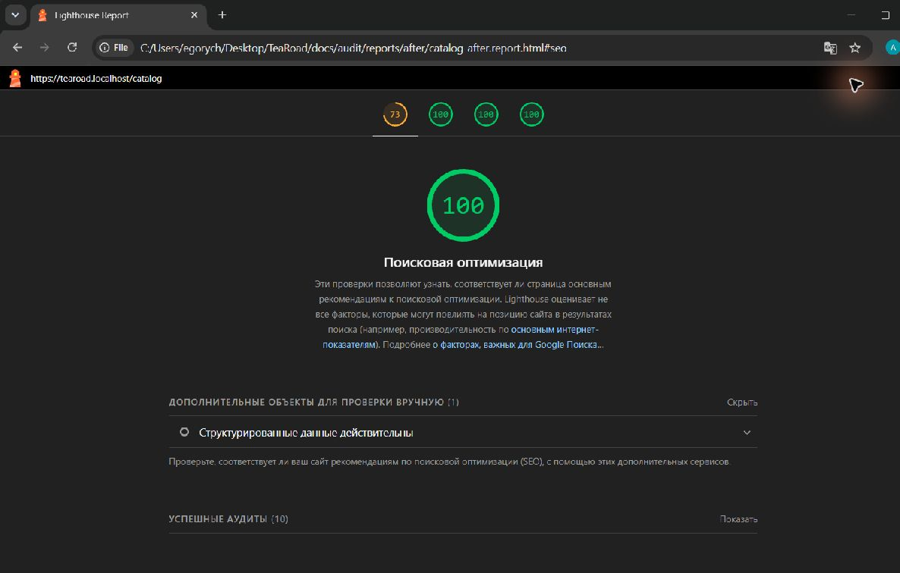
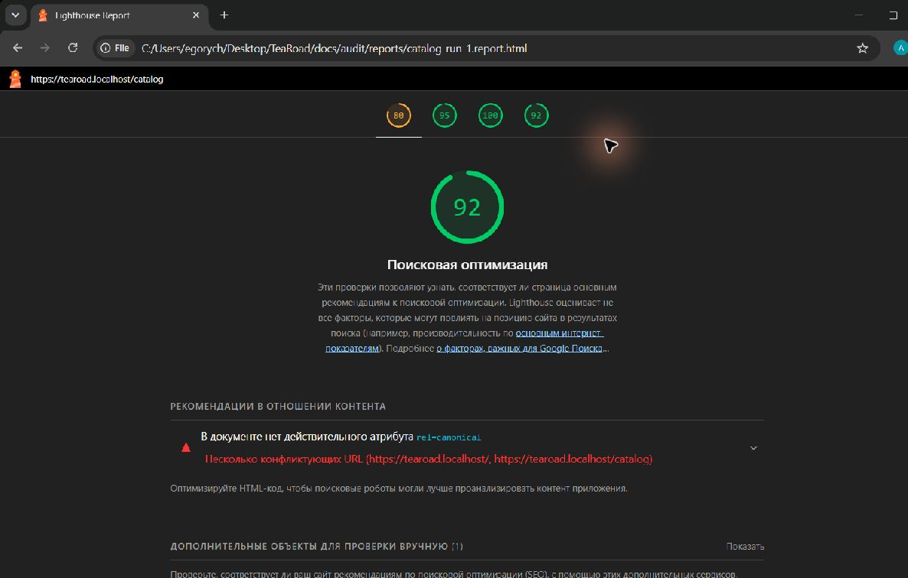
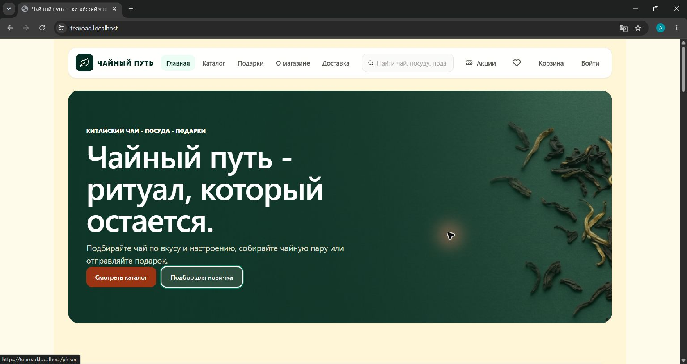
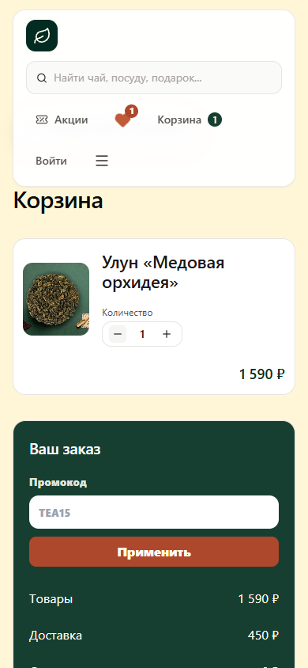
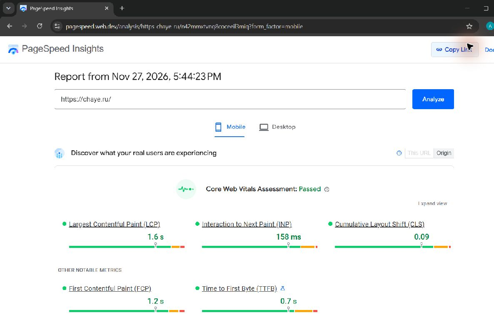
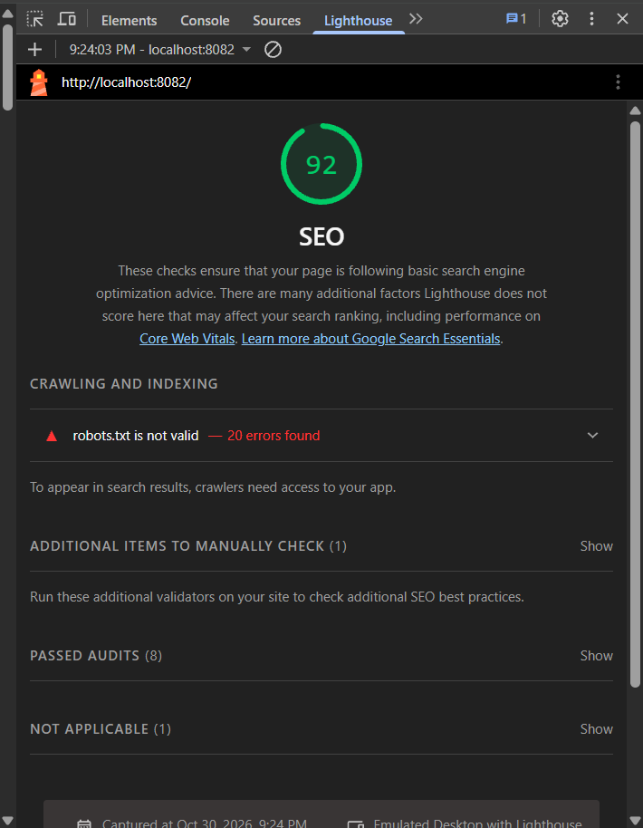
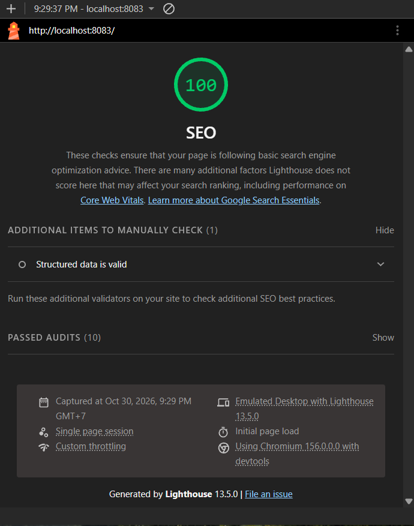

# Практическое занятие №19 — SEO и аналитика TeaRoad

**Студент:** Егор Горычев · **Группа:** PR-24.102  
**Дата:** 27.11.2026 · **Ветка:** `practical-19-seo-audit`  
**Стенд:** production-сборка Docker Compose, `https://tearoad.localhost`  
**Исходная версия:** `main`, commit `92b685dd6a2c66783fa58ebe0c367de019ca19c9`.

## Методика и проверенные страницы

Собран production Docker-образ из исходников этой ветки; контейнер `app` прошёл healthcheck. Lighthouse запускался в режиме Navigation/Desktop, с категориями Performance, Accessibility, Best Practices и SEO. Для публичных адресов сделано по три исходных запуска; для закрытых — по одному, без SEO. Сводные оценки и медианы — в [таблице Lighthouse](lighthouse-summary.md), исходные HTML/JSON — в `reports/`.

Проверены главная, каталог, подарки, акции, о магазине, доставка, подбор чая и все 17 активных товаров — **24 публичных URL**. Закрытые `/favorites`, `/cart`, `/checkout`, `/login`, `/register`, `/recover` проверялись без категории SEO. `/profile` не открывался после входа, чтобы не сохранять персональные данные. Неизвестный URL вручную возвращает HTTP 200 через SPA fallback — это soft 404.

После исправлений SEO и Accessibility повторно проверены все 24 публичных URL. Пять контрольных отчётов с четырьмя категориями — главная, каталог, «О магазине», акции и корзина; корзина в итоговой таблице учитывается только по Performance/Accessibility/Best Practices, поскольку закрыта от индексации.

## Lighthouse: до и после

| Страница/проверка | До | После | Результат |
|---|---:|---:|---|
| SEO, главная | 100 | 100 | Сохранено |
| SEO, остальные публичные URL | 92 | 100 | Исправлены дубли canonical |
| Accessibility, главная | 91 | 100 | Контраст и размер кнопок слайдера исправлены |
| Accessibility, публичные страницы | 95 | 100 | Контраст исправлен |
| Accessibility, корзина | 95 | 100 | Исправлен контраст итоговой карточки |
| Best Practices, контрольные страницы | 100 | 100 | Без изменений |

После исправлений единичный Performance: главная 68, каталог 73, «О магазине» 94, акции 91, корзина 96. Эти значения не сравниваются с медианой исходных трёх запусков: Lighthouse Performance заметно зависит от нагрузки и сети. Исходные три замера и медианы приведены в `lighthouse-summary.md`.

| Исправление | Было | Стало | Скриншоты/отчёты |
|---|---|---|---|
| Canonical на каталоге | 2 canonical URL, SEO 92 | один canonical, SEO 100 | [до](screenshots/lighthouse-seo-catalog.jpg) · [после](screenshots/lighthouse-seo-after-catalog.jpg) · [HTML после](reports/after/catalog-after.report.html) |
| Контраст и точки слайдера | Accessibility главной 91, каталога 95; target size 9×9 px | главная и каталог 100; ошибок target size нет | [сводка до](screenshots/lighthouse-catalog-summary.jpg) · [сводка после](screenshots/lighthouse-seo-after-catalog.jpg) · [HTML после](reports/after/home-after.report.html) |
| Контраст блока заказа | Accessibility корзины 95 | Accessibility 100 | [HTML после](reports/after/cart-after.report.html) |

Скриншоты реальных HTML-отчётов Lighthouse:

## Клавиатурная навигация

Вручную проверил главную страницу: после фокуса на странице Tab переводит фокус на первую CTA «Смотреть каталог», следующий Tab — на «Подбор для новичка». У обеих кнопок видна контрастная рамка `focus-visible`. Это подтверждает работу последовательного перехода на главной; полный маршрут по всем интерактивным элементам и страницам ещё не пройден.

## Core Web Vitals и взаимодействия

Измерение выполнено в Chrome 158 через Chrome DevTools Protocol, mobile viewport 390×844, с реальными кликами по действиям сайта. Это лабораторная короткая сессия, а `estimatedINP` — самое медленное из двух наблюдавшихся взаимодействий, не полевая 75-я перцентиль CrUX.

| Страница | LCP | INP, оценка по сессии | CLS | Оценка лабораторных метрик |
|---|---:|---:|---:|---|
| `/product/ulun-honey-orchid` | 676 мс | 104 мс | 0.000 | Хорошо |
| `/cart` | 364 мс | 16 мс | 0.000 | Хорошо |

Действия: добавление товара в корзину и избранное; увеличение и уменьшение количества в корзине. Данные и временные отметки: [`cwv-interactions.json`](reports/cwv-interactions.json). Снимок mobile-сценария: .

Для `tearoad.localhost` полевые CrUX-данные недоступны. Сайт-аналог в PageSpeed Insights — [chaye.ru](https://chaye.ru/), mobile, данные пользователей за последние 28 дней на 27.11.2026: CWV пройдены, LCP 1.6 с, INP 158 мс, CLS 0.09. Это именно полевые данные сайта-аналога и их нельзя напрямую сравнивать с нашей лабораторной сессией.

Выводы: у сайта-аналога полевые LCP и INP в зелёной зоне; его CLS 0.09 близок к порогу 0.1. Наши лабораторные замеры показали нулевой CLS на двух сценариях, но не заменяют сбор реального трафика.

## Ручные SEO-проверки

- `/robots.txt` и `/sitemap.xml` отвечают HTTP 200; sitemap содержит 24 URL: 7 разделов и 17 текущих товаров.
- Закрытые страницы отдают `X-Robots-Tag: noindex, nofollow`; они остаются доступны для чтения этой директивы.
- Для публичных маршрутов после загрузки приложения установлен один соответствующий canonical. До исправления Lighthouse находил два canonical на страницах кроме главной.
- Заголовок и description маршрутов задаются клиентским React-кодом. Исходный HTML содержит шаблонные метаданные, поэтому надёжность индексирования зависит от выполнения JavaScript; рассмотреть prerender/SSR.
- Неизвестный путь отдаёт HTTP 200 и страницу приложения вместо HTTP 404 — soft 404 остаётся.
- Клавиатурный проход по всем маршрутам не завершён; на главной вручную проверены два последовательных перехода Tab и видимый фокус.

Замеры занятий 70–71 из `docs/seo/before.png` и `docs/seo/after.png` показывают SEO 92 → 100; в старом снимке Lighthouse также отмечал невалидный robots.txt. Это предыдущая проверка, не часть текущей сборки.

В текущем аудите каталог отдельно изменился с SEO 92 до 100 после устранения двух canonical-ссылок.

## Найденные проблемы и приоритеты

| Приоритет | Проблема | Страница | Влияние | Сложность | Решение/статус |
|---:|---|---|---|---|---|
| 1 | Дублирующий canonical | Публичные маршруты | Высокое | Низкая | Исправлено: обновляется существующий link, дубликаты удаляются; SEO 100 |
| 2 | Слабый контраст текста | Главная, акции, «О магазине», корзина и отдельные блоки | Среднее | Низкая | Исправлены цвета muted, kicker, olive/clay и заголовок заказа; Accessibility 100 |
| 3 | Точки слайдера 9×9 px | Главная | Среднее | Низкая | Кликабельная область 24×24 px; ошибка target-size исчезла |
| 4 | Нет динамической генерации sitemap | Товары | Среднее | Средняя | Сейчас включён список из 17 текущих товаров; обновлять вместе с каталогом или генерировать на сборке |
| 5 | Метаданные добавляются после выполнения JS | Публичные страницы | Среднее | Высокая | Остаётся; улучшить prerender/SSR |
| 6 | SPA fallback даёт 200 для неизвестного URL | Несуществующий адрес | Среднее | Средняя | Остаётся; возвращать 404 для неизвестных путей |
| 7 | Не завершён полный keyboard-аудит | Все страницы | Среднее | Низкая | Частично проверена главная: два перехода Tab и видимый focus работают; остальные маршруты требуют полного прохода |
| 8 | Нельзя получить CrUX для локального домена | Весь сайт | Низкое для локального аудита | — | Ограничение стенда; собирать полевые данные после публичного запуска |

## Файлы доказательств

- Все исходные отчёты Lighthouse: [`reports/`](reports/); итоговые проверки после исправлений: [`reports/after/`](reports/after/).
- Скриншоты: [`screenshots/`](screenshots/).
- Скрипты аудита Lighthouse и взаимодействий: [`../../tools/run-lighthouse-audit.ps1`](../../tools/run-lighthouse-audit.ps1), [`../../tools/run-cwv-interactions.mjs`](../../tools/run-cwv-interactions.mjs).
- PageSpeed Insights API в этой среде отвечал ограничением квоты; снимок получен через официальный веб-интерфейс PSI.

## Заключение

Проведены исходные Lighthouse-замеры 24 публичных и 6 закрытых страниц, рассчитаны медианы, проверены метаданные и файлы индексации, измерены лабораторные LCP/INP/CLS, выполнено сравнение с chaye.ru в PageSpeed Insights. Исправлены canonical, контраст и размер целей слайдера; повторная проверка показала SEO 100 на публичных URL и Accessibility 100 на контрольных маршрутах. Soft 404, клиентская выдача метаданных, полный клавиатурный проход по всем маршрутам и отсутствие полевых данных для локального сайта зафиксированы как оставшиеся ограничения.
